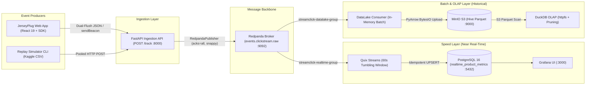

# StreamClick — E-Commerce Clickstream Analytics Platform

Nền tảng thu thập, xử lý thời gian thực và lưu trữ phân tích dữ liệu hành vi người dùng (Clickstream) cho hệ thống E-commerce theo kiến trúc **Lambda Architecture**, tuân thủ chuẩn **12-Factor App**, **Data Contracts** và **Ports & Adapters**.

> [!NOTE]
> **Lưu ý hiển thị sơ đồ (Mermaid.js):** Toàn bộ sơ đồ kiến trúc, luồng dữ liệu và ERD trong `README.md` và thư mục `docs/` sử dụng cú pháp **Mermaid**. Nếu bạn đọc tài liệu trực tiếp trên IDE (chưa xem trên GitHub), vui lòng bật hoặc cài đặt plugin hỗ trợ **Mermaid** (ví dụ: bật *Mermaid* trong *Settings -> Languages & Frameworks -> Markdown* trên **PyCharm / IntelliJ**, hoặc cài extension *Markdown Preview Mermaid Support* trên **VS Code**) để hiển thị đầy đủ các sơ đồ trực quan.

---

## Vấn đề & Giải pháp (Problem Statement)

Hệ thống E-commerce phát sinh luồng sự kiện tương tác liên tục (`view_item`, `product_view`, `add_to_cart`, `checkout`, `purchase`) với hai nhu cầu khai thác đối lập:

1. **Low-Latency Operational Metrics (Speed Layer):** Đội ngũ Vận hành cần theo dõi biến động lượt tương tác sản phẩm theo từng khung cửa sổ 60 giây gần thời gian thực.
2. **Immutable Historical Analytics (Batch Layer):** Đội ngũ Data Engineering / BI cần lưu trữ toàn bộ sự kiện thô dưới định dạng nén cột **Apache Parquet** phân vùng theo thời gian để chạy truy vấn **OLAP SQL** chi phí thấp mà không làm nghẽn cơ sở dữ liệu giao dịch.

**StreamClick** giải quyết đồng thời hai bài toán trên bằng một pipeline phân tán gọn nhẹ chạy độc lập qua **Docker Compose** (~1.31 GiB RAM giới hạn cho toàn cụm container), đồng thời tách biệt hoàn toàn Core Domain khỏi SDK hạ tầng để sẵn sàng chuyển dịch lên Cloud.

---

## Kiến trúc Tổng quan (As-Is Architecture)



---

## Điểm nhấn Kỹ thuật (Core Engineering Highlights)

* **Strict 4W1H Data Contract & PII Whitelist:** Mọi payload đi qua `POST /track` đều được xác thực bằng Pydantic V2 (`ClickstreamEvent`), tự động loại bỏ các trường ngoài danh sách cho phép (`extra="ignore"`) để ngăn rò rỉ PII ngay từ biên mạng và trả về `202 Accepted` bất đồng bộ.
* **Hexagonal Ports & Adapters:** Tách biệt giao diện `AbstractMessagePublisher` và `AbstractStorageClient` khỏi triển khai cụ thể (`RedpandaPublisher`, `MinIOClient`), kết hợp **Thread-Safe Double-Checked Locking Singleton** và HTTP/TCP Connection Pooling.
* **Dual-Pipeline Reliability:**
  * **Speed Layer:** `Quix Streams` gom nhóm theo cửa sổ **60-second Tumbling Window** và ghi `ON CONFLICT DO UPDATE` (Idempotent UPSERT) vào `PostgreSQL`.
  * **Batch Layer:** `DataLakeConsumer` tắt `enable.auto.commit`, gom micro-batch trên RAM (`5,000` bản ghi hoặc `60s`), nén **Parquet** trực tiếp qua `io.BytesIO` (không ghi file tạm ra đĩa), đẩy lên `MinIO` theo phân vùng Hive `year/month/day/hour` rồi mới commit Kafka offset (*At-Least-Once delivery*).
* **Resilient Browser Tracking SDK:** TypeScript SDK trên storefront tích hợp cơ chế **Dual-Flush** (`10` events hoặc mỗi `3s`), quản lý phiên trượt 30 phút (*Sliding Session TTL*), và tự động xả hàng đợi khẩn cấp qua `navigator.sendBeacon` khi người dùng đóng tab.

---

## Khởi chạy Nhanh trong 3 Bước (Quickstart)

> **Yêu cầu:** Docker Compose v2+, Python 3.10+, và [`uv`](https://docs.astral.sh/uv/).

### Bước 1 — Cấu hình biến môi trường & bật hạ tầng cục bộ

```bash
cp .env.example .env
# Điền các biến bắt buộc trong .env (xem chi tiết tại docs/operations/runbook.md)
docker compose up -d
```

### Bước 2 — Cài đặt môi trường Python & khởi chạy các dịch vụ Pipeline

```bash
uv sync

# Mở 3 tab terminal riêng biệt (hoặc dùng `docker compose --profile app up -d`):
uv run uvicorn api.main:app --host 0.0.0.0 --port 8000
uv run python -m streaming.processor
uv run python batch/datalake_consumer.py
```

### Bước 3 — Bắn sự kiện giả lập & kiểm tra dữ liệu

```bash
# Bắn 200 sự kiện thử nghiệm vào Ingestion API
uv run python -m simulator.main -l 200 -d 0.01

# Chạy bộ kiểm thử tích hợp các module cốt lõi
uv run python infrastructure/scripts/test_pipeline_modules.py --all
```

Truy cập nhanh các giao diện quản trị cục bộ:
* **Swagger API Docs:** `http://localhost:8000/docs`
* **Redpanda Console:** `http://localhost:8080`
* **MinIO Console:** `http://localhost:9001`
* **Grafana UI:** `http://localhost:3000`

---

## Danh mục Tài liệu Hệ thống (Documentation Hub)

| Nhóm Tài liệu | Tài liệu | Nội dung Chính |
| :--- | :--- | :--- |
| **Architecture** | [System Overview](docs/architecture/system-overview.md) | Kiến trúc chuẩn **arc42**, sơ đồ **C4 Context & Container**, End-to-End Sequence Diagram và ranh giới Ports & Adapters. |
| **Architecture Decisions** | [ADR Directory](docs/architecture/adr/0000-template.md) | Hồ sơ quyết định kiến trúc (**MADR**): [ADR-0001 Lambda](docs/architecture/adr/0001-lambda-architecture-dual-pipeline.md), [ADR-0002 Adapters](docs/architecture/adr/0002-ports-and-adapters-singleton-pooling.md), [ADR-0003 Data Contract](docs/architecture/adr/0003-pydantic-v2-whitelist-data-contract.md), [ADR-0004 SDK Transport](docs/architecture/adr/0004-sdk-dual-flush-and-beacon-transport.md), [ADR-0005 Local Stack](docs/architecture/adr/0005-lightweight-local-stack-in-memory-parquet.md). |
| **Data Engineering** | [Data Contracts & Schemas](docs/data/data-contracts-and-schemas.md) | Đặc tả trường dữ liệu `ClickstreamEvent`, quy tắc xác thực, bảng PostgreSQL, phân vùng Parquet trên MinIO và sơ đồ Data Lineage. |
| **Analytics & BI** | [Analytics & Metrics](docs/data/analytics-and-metrics.md) | Logic cửa sổ thời gian 60s, cơ chế chống trùng lặp (Idempotency), truy vấn DuckDB OLAP và hệ thống chỉ số phễu chuyển đổi. |
| **API Reference** | [Ingestion API](docs/api/ingestion-api.md) | Đặc tả `POST /track` (đơn lẻ & batch), `GET /health`, mã lỗi HTTP và ví dụ tích hợp. |
| **Operations** | [Operations Runbook](docs/operations/runbook.md) | Bảng tham chiếu biến môi trường đầy đủ, quản lý vòng đời Docker Compose, chạy Simulator và ma trận xử lý sự cố (Troubleshooting Matrix). |
| **Cloud Migration** | [GCP Readiness Baseline](docs/migration/gcp-readiness-baseline.md) | Đánh giá hiện trạng **As-Is**, các điểm nối Adapter sẵn có, điểm nghẽn coupling cần gỡ bỏ và kiến trúc mục tiêu **Planned GCP Serverless**. |

---

## Cấu trúc Thư mục (Repository Layout)

```text
StreamClick/
├── api/                    # Stateless FastAPI Ingestion Service (/track, /health)
├── batch/                  # Kafka-to-Parquet Micro-batch Consumer ghi vào MinIO
├── streaming/              # Quix Streams 60s Tumbling Window Processor ghi vào PostgreSQL
├── analytics/              # DuckDB OLAP connector & tập lệnh truy vấn SQL mẫu
├── core/                   # Shared Settings (12-Factor), Pydantic Schemas & Port/Adapter ABCs
├── sdk/tracking/           # Browser TypeScript Tracking SDK (Dual-Flush, sendBeacon, Session TTL)
├── frontend/               # React 19 + Vite E-commerce Storefront (JerseyPlug)
├── simulator/              # CLI Replay Generator phát sự kiện từ Kaggle CSV dataset
├── infrastructure/         # SQL khởi tạo Docker và Extensible Module Test Harness
├── tests/                  # Unit / Integration / E2E test suites
└── docs/                   # Bộ tài liệu kiến trúc, dữ liệu, API, vận hành & Cloud Migration
```
