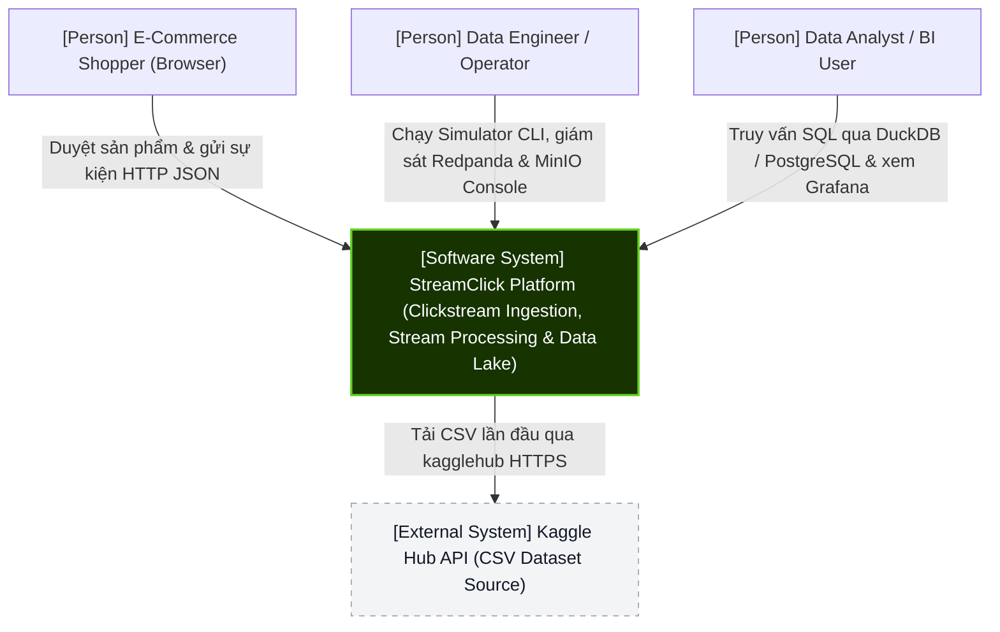
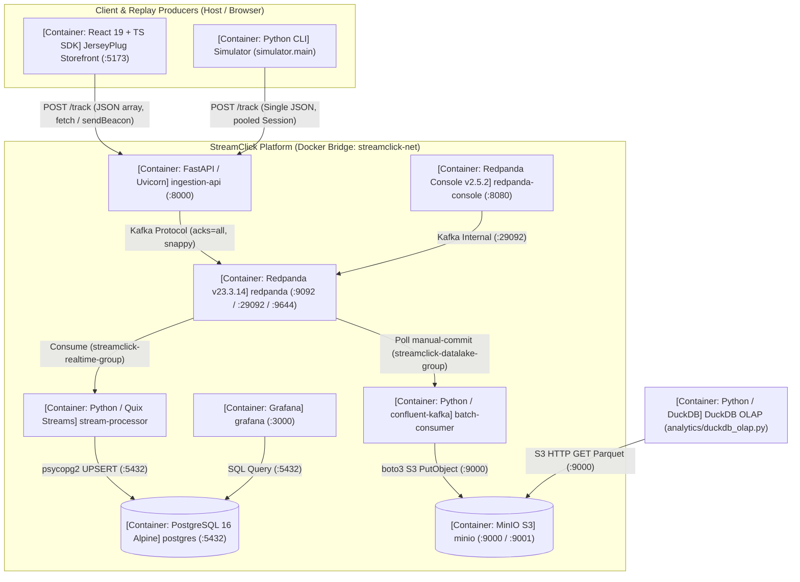
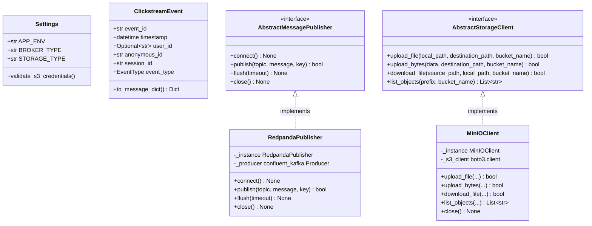
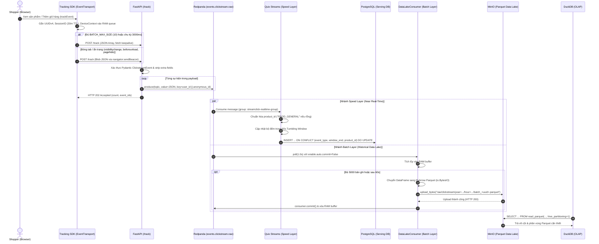

# Tổng quan Kiến trúc Hệ thống (System Overview)

Tài liệu này mô tả kiến trúc hiện hành (**As-Is Architecture**) của **StreamClick** theo khung chuẩn **arc42** và mô hình trực quan hóa **C4 Model**. Mọi cổng mạng, tên container, giao thức và ranh giới module đều được đối chiếu trực tiếp từ mã nguồn trong repository.

---

## 1. Bối cảnh & Mục tiêu Kiến trúc (Introduction & Goals)

**StreamClick** là nền tảng thu thập và phân tích luồng sự kiện Clickstream cho thương mại điện tử. Kiến trúc hệ thống được thiết kế để thỏa mãn ba mục tiêu kỹ thuật cốt lõi:

1. **Tách biệt tải đọc/ghi và độ trễ (Lambda Architecture):** Cung cấp đồng thời số liệu tổng hợp gần thời gian thực (chu kỳ cửa sổ 60 giây) và kho lưu trữ lịch sử định dạng cột (Apache Parquet) phục vụ phân tích OLAP.
2. **Bảo vệ chất lượng dữ liệu ngay từ biên (Schema-on-Write):** Xác thực cấu trúc sự kiện 4W1H, chuẩn hóa kiểu dữ liệu và loại bỏ trường không khai báo trước khi đẩy vào Message Broker.
3. **Độc lập hạ tầng (Infrastructure Portability):** Cô lập logic nghiệp vụ khỏi thư viện giao tiếp Kafka/S3 thông qua tầng trừu tượng **Ports & Adapters** và cấu hình **12-Factor App**.

---

## 2. Sơ đồ Ngữ cảnh Hệ thống — C4 Level 1 (System Context)

Sơ đồ dưới đây thể hiện ranh giới của **StreamClick** và cách các tác nhân bên ngoài tương tác với nền tảng:

*(Ghi chú: Kết nối tới Kaggle Hub chỉ kích hoạt khi chạy công cụ giả lập mà chưa có sẵn file CSV cục bộ trong `data/raw/`).*

---

## 3. Sơ đồ Thành phần Container — C4 Level 2 (Container Diagram)

Ở cấp độ Container, hệ thống bao gồm các ứng dụng phía client, các tiến trình xử lý Python 3.11 và cụm hạ tầng lưu trữ/broker định nghĩa trong `docker-compose.yml`:

---

## 4. Ranh giới Trừu tượng Ports & Adapters (Component Boundaries)

Module `core/` đóng vai trò hạt nhân dùng chung giữa `api/`, `batch/`, `streaming/` và `simulator/`. Logic nghiệp vụ được tách khỏi các thư viện giao tiếp ngoại vi thông qua hai Port Interface:

### Đặc tính kỹ thuật tại ranh giới Adapter
* **Message Broker Seam (`core/adapters/broker/`):** `AbstractMessagePublisher` định nghĩa hợp đồng gửi sự kiện kèm `key` phân vùng. `RedpandaPublisher` triển khai **Thread-Safe Singleton** (`threading.Lock`), gom lô `linger.ms=5`, nén `snappy`, đảm bảo độ bền `acks='all'` và tự xả đệm khi gặp `BufferError`.
* **Object Storage Seam (`core/adapters/storage/`):** `AbstractStorageClient` định nghĩa phương thức `upload_bytes()` truyền thẳng byte buffer từ RAM. `MinIOClient` quản lý `boto3` connection pool (`max_pool_connections=50`), tự động thử lại (`mode="adaptive"`, tối đa 3 lần) và tự kiểm tra/khởi tạo bucket khi khởi động (`_ensure_bucket_exists`).
* **Lưu ý hiện trạng (As-Is Coupling):** Dù interface đã tách biệt sạch sẽ, `api/main.py` hiện đang khởi tạo trực tiếp `RedpandaPublisher` trong hàm `lifespan`, và `batch/datalake_consumer.py` khởi tạo trực tiếp `MinIOClient` + `confluent_kafka.Consumer`. Chi tiết điểm nối này được ghi nhận tại [GCP Readiness Baseline](../migration/gcp-readiness-baseline.md).

---

## 5. Luồng Xử lý Sự kiện Đầu-Cuối (End-to-End Sequence Flow)

Sơ đồ tuần tự dưới đây mô tả vòng đời hoàn chỉnh của một sự kiện từ lúc phát sinh trên trình duyệt đến khi xuất hiện ở cả hai nhánh Speed Layer và Batch Layer:

---

## 6. Triển khai & Phân bổ Tài nguyên (Deployment & Resource View)

Trong `docker-compose.yml`, hệ thống phân tách nhóm dịch vụ nền tảng chạy mặc định và nhóm container ứng dụng chạy theo Docker Compose Profile `app` (để lập trình viên linh hoạt chạy code trực tiếp bằng `uv run` trên máy host khi debug):

| Container / Service | Docker Profile | Cổng Host : Container | Giới hạn CPU | Giới hạn RAM | Lưu trữ (Volume / State) |
| :--- | :---: | :---: | :---: | :---: | :--- |
| `streamclick-redpanda` | *Default* | `9092:9092`, `9644:9644` | `0.50` | `384M` | Ephemeral container fs |
| `streamclick-redpanda-console` | *Default* | `8080:8080` | `0.10` | `64M` | Stateless |
| `streamclick-minio` | *Default* | `9000:9000`, `9001:9001` | `0.25` | `128M` | Named volume `minio_data` |
| `streamclick-postgres` | *Default* | `5432:5432` | `0.25` | `128M` | Named volume `postgres_data` |
| `streamclick-grafana` | *Default* | `3000:3000` | *Không giới hạn* | *Không giới hạn* | Ephemeral container fs |
| `streamclick-ingestion-api` | `app` | `8000:8000` | `0.50` | `192M` | Stateless |
| `streamclick-stream-processor` | `app` | *Internal only* | `0.50` | `192M` | Local state dir (`state/` khi chạy host) |
| `streamclick-batch-consumer` | `app` | *Internal only* | `0.50` | `256M` | Stateless (`io.BytesIO` trên RAM) |

* **Tổng giới hạn tài nguyên khai báo (7 container có limit):** `2.60 CPU cores` và `1,344 MiB (~1.31 GiB) RAM`.
* **Mạng nội bộ:** Toàn bộ container giao tiếp qua mạng bridge `streamclick-net`; Redpanda lắng nghe song song trên `PLAINTEXT://redpanda:29092` (cho nội bộ Docker) và `OUTSIDE://localhost:9092` (cho tiến trình chạy trên máy host).
