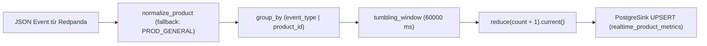

# Phân tích Dữ liệu, Cửa sổ Thời gian & Hệ thống Chỉ số (Analytics & Metrics)

Tài liệu này mô tả cơ chế tính toán luồng thời gian thực tại **Speed Layer**, phương pháp truy vấn OLAP trực tiếp trên Data Lake tại **Batch Layer**, và danh mục các chỉ số đo lường hiệu quả kinh doanh (KPIs) của **StreamClick**.

---

## 1. Xử lý Cửa sổ Thời gian Thực — Speed Layer (`streaming/processor.py`)

### 1.1. Luồng Biến đổi & Cửa sổ Trượt Không Chồng lấp (60s Tumbling Window)

`streaming/processor.py` sử dụng thư viện `Quix Streams` kết nối vào Redpanda với `consumer_group="streamclick-realtime-group"` và `auto_offset_reset="latest"`:



### 1.2. Đặc tính Kỹ thuật Quan trọng
* **Chuẩn hóa Khóa Nhóm (`normalize_product`):** Các sự kiện không gắn với sản phẩm cụ thể (`product_id` là `None` hoặc chuỗi rỗng) được gán nhãn mặc định `"PROD_GENERAL"` để không làm rơi dữ liệu khi tạo khóa chính `NOT NULL` trên PostgreSQL.
* **Cơ chế Phát Tức thời (`.current()`):** Thay vì chờ hết trọn 60 giây mới phát kết quả cuối cùng (`.final()`), pipeline gọi `.current()` sau bước `reduce()`. Mỗi khi có sự kiện mới rơi vào khung 1 phút hiện hành, bộ đếm cập nhật ngay lập tức và thực thi lệnh `UPSERT` xuống PostgreSQL:
  ```sql
  INSERT INTO realtime_product_metrics (event_type, window_end, product_id, event_count)
  VALUES (%s, %s, %s, %s)
  ON CONFLICT (event_type, window_end, product_id)
  DO UPDATE SET event_count = EXCLUDED.event_count;
  ```
* **Quản lý Trạng thái Cục bộ:** Quix Streams lưu trữ trạng thái bộ đếm của từng cửa sổ dưới thư mục `state/streamclick-realtime-group/` để phục hồi số đếm nếu tiến trình khởi động lại giữa khung 60 giây.

---

## 2. Động cơ Phân tích Lịch sử — Batch OLAP Layer (`analytics/`)

Thay vì dựng máy chủ Data Warehouse tốn kém tài nguyên, `analytics/duckdb_olap.py` khởi tạo **DuckDB** ngay trên bộ nhớ (`:memory:`), nạp tiện ích mở rộng `httpfs` và đăng ký chứng chỉ S3 (`CREATE SECRET minio_secret`) từ cấu hình `core.config.settings` để đọc trực tiếp các tệp Parquet trên MinIO.

### Cơ chế Tối ưu Hóa Truy vấn
1. **Hive Partition Pruning:** Khi bật tham số `hive_partitioning=1` trong hàm `read_parquet()`, DuckDB tự động trích xuất các cột ảo `year`, `month`, `day`, `hour` từ đường dẫn thư mục trên MinIO. Mệnh đề `WHERE year = 2026 AND month = 11 AND day = 25` giúp bỏ qua toàn bộ các thư mục ngày khác mà không cần tải file qua mạng.
2. **Columnar Projection Pushdown:** Định dạng Apache Parquet chỉ truyền qua mạng đúng các cột được nêu trong mệnh đề `SELECT` (ví dụ chỉ đọc `event_type` và `price`), giảm mạnh băng thông I/O so với đọc JSON thô.

---

## 3. Bộ Truy vấn & Chỉ số KPI Thương mại Điện tử

### 3.1. Truy vấn Thời gian thực trên PostgreSQL (`streamclick` DB)

**1) Lưu lượng sự kiện toàn hệ thống theo từng phút gần nhất (từ View `realtime_event_metrics`):**
```sql
SELECT
    window_end,
    event_type,
    event_count
FROM public.realtime_event_metrics
ORDER BY window_end DESC, event_count DESC
LIMIT 20;
```

**2) Bảng xếp hạng Top 10 sản phẩm được xem hoặc thêm vào giỏ nhiều nhất trong 15 phút qua:**
```sql
SELECT
    product_id,
    SUM(CASE WHEN event_type IN ('view_item', 'product_view') THEN event_count ELSE 0 END) AS total_views,
    SUM(CASE WHEN event_type = 'add_to_cart' THEN event_count ELSE 0 END) AS total_cart_adds
FROM public.realtime_product_metrics
WHERE window_end >= NOW() - INTERVAL '15 minutes'
  AND product_id <> 'PROD_GENERAL'
GROUP BY product_id
ORDER BY total_views DESC
LIMIT 10;
```

### 3.2. Truy vấn Phân tích Chuyên sâu trên DuckDB (MinIO Parquet Data Lake)

Sau khi khởi tạo kết nối qua `inital_duckdb()` và `configure_minio(conn)` trong `analytics/duckdb_olap.py` (thay `<S3_BUCKET_NAME>` bằng tên bucket trong `.env`, ví dụ `clickstream-lake`):

**1) Phân tích Tỷ lệ Chuyển đổi Phễu Mua hàng (Funnel Conversion Rate) có khử trùng lặp `event_id`:**
```sql
WITH dedup_events AS (
    SELECT DISTINCT ON (event_id)
        event_id,
        session_id,
        event_type,
        price
    FROM read_parquet(
        's3://clickstream-lake/raw/clickstream/*/*/*/*/*.parquet',
        hive_partitioning = 1
    )
)
SELECT
    COUNT(DISTINCT CASE WHEN event_type IN ('view_item', 'product_view') THEN session_id END) AS view_sessions,
    COUNT(DISTINCT CASE WHEN event_type = 'add_to_cart' THEN session_id END) AS cart_sessions,
    COUNT(DISTINCT CASE WHEN event_type = 'checkout' THEN session_id END) AS checkout_sessions,
    COUNT(DISTINCT CASE WHEN event_type = 'purchase' THEN session_id END) AS purchase_sessions,
    ROUND(
        COUNT(DISTINCT CASE WHEN event_type = 'purchase' THEN session_id END) * 100.0
        / NULLIF(COUNT(DISTINCT CASE WHEN event_type IN ('view_item', 'product_view') THEN session_id END), 0),
        2
    ) AS session_conversion_pct
FROM dedup_events;
```

**2) Phân tích Doanh thu Ghi nhận & Giá trị Trung bình theo Hệ điều hành Thiết bị:**
```sql
SELECT
    device.os AS client_os,
    COUNT(DISTINCT event_id) AS purchase_events,
    ROUND(SUM(COALESCE(price, 0)), 2) AS gross_revenue,
    ROUND(AVG(COALESCE(price, 0)), 2) AS avg_item_price
FROM read_parquet(
    's3://clickstream-lake/raw/clickstream/*/*/*/*/*.parquet',
    hive_partitioning = 1
)
WHERE event_type = 'purchase'
GROUP BY device.os
ORDER BY gross_revenue DESC;
```

---

## 4. Trực quan hóa Dashboard (Grafana Integration)

Container `streamclick-grafana` được định nghĩa sẵn trong `docker-compose.yml` tại cổng `http://localhost:3000` (tài khoản mặc định của image Grafana chính thức: `admin` / `admin`) và nối chung mạng nội bộ `streamclick-net` với `postgres`.

* **Trạng thái cấu hình hiện hành (As-Is):** Repository chưa đính kèm tệp provisioning tự động cho Grafana datasource/dashboard. Để kết nối bảng biểu trực tiếp khi chạy local:
  1. Đăng nhập `http://localhost:3000` -> **Connections** -> **Data sources** -> **Add new data source** -> chọn **PostgreSQL**.
  2. Điền **Host URL:** `postgres:5432`, **Database name:** `streamclick`, **Username:** `postgres`, **Password:** giá trị `POSTGRES_PASSWORD` trong `docker-compose.yml` (`postgres_secret_pw`), **TLS/SSL Mode:** `disable`.
  3. Sử dụng hai truy vấn tại mục **3.1** để dựng biểu đồ Time-Series theo cột `window_end` và bảng xếp hạng sản phẩm.
