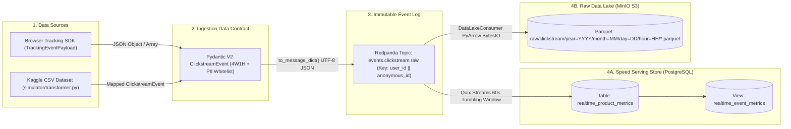
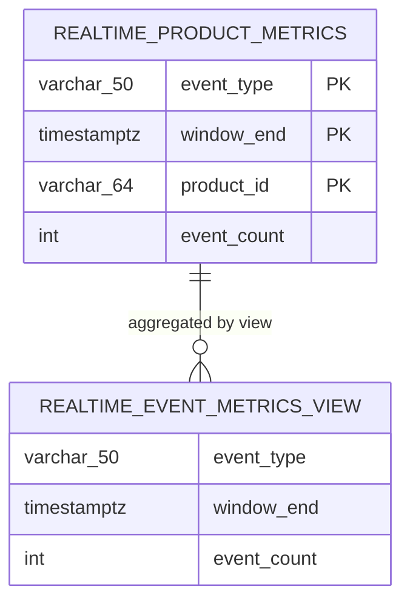

# Hợp đồng Dữ liệu & Cấu trúc Lưu trữ (Data Contracts & Schemas)

Tài liệu này định nghĩa đặc tả kỹ thuật cho toàn bộ cấu trúc dữ liệu trong **StreamClick**, bao gồm hợp đồng sự kiện đầu vào tại `core/schemas/clickstream.py`, cơ chế định tuyến phân vùng trên Redpanda, cấu trúc lưu trữ Parquet trên MinIO và các bảng quan hệ trên PostgreSQL.

---

## 1. Sơ đồ Dòng chảy & Biến đổi Dữ liệu (Data Lineage)



---

## 2. Hợp đồng Sự kiện Cốt lõi (`ClickstreamEvent`)

Định nghĩa tại `core/schemas/clickstream.py`, lớp `ClickstreamEvent` đóng vai trò cổng kiểm soát chất lượng dữ liệu bắt buộc trước khi sự kiện đi vào Message Broker.

### 2.1. Chính sách Xác thực Cấp Mô hình (`ConfigDict`)
* **`extra = "ignore"` (PII Whitelist Mode):** Tự động loại bỏ mọi trường JSON không được khai báo trong schema ở cấp độ root và `device`, ngăn chặn việc rò rỉ dữ liệu nhạy cảm ngoài dự kiến.
* **`str_strip_whitespace = True`:** Tự động cắt bỏ khoảng trắng thừa ở hai đầu cho toàn bộ trường kiểu chuỗi (`str`).
* **`populate_by_name = True`:** Cho phép khởi tạo model linh hoạt theo tên thuộc tính chuẩn.

### 2.2. Đặc tả Chi tiết Các Trường (`ClickstreamEvent`)

| Tên trường | Kiểu Python / JSON | Bắt buộc | Giá trị mặc định | Quy tắc & Ý nghĩa Nghiệp vụ (4W1H) |
| :--- | :--- | :---: | :--- | :--- |
| `event_id` | `str` (UUIDv4) | Không | `str(uuid.uuid4())` | **WHO/ID:** Mã định danh duy nhất toàn cục phục vụ khử trùng lặp (Deduplication) ở hạ nguồn. |
| `timestamp` | `datetime` / `string` | Không | `datetime.now(timezone.utc)` | **WHEN:** Thời điểm phát sinh sự kiện; khi xuất sang broker qua `to_message_dict()` được chuẩn hóa thành chuỗi ISO 8601. |
| `user_id` | `Optional[str]` | Không | `None` | **WHO:** Định danh tài khoản khách hàng đã đăng nhập. |
| `anonymous_id` | `str` | **Có** | — | **WHO:** Định danh thiết bị/trình duyệt ẩn danh (ví dụ `anon_<uuid>`). |
| `session_id` | `str` | **Có** | — | **WHO:** Mã phiên duyệt web của người dùng (ví dụ `sess_<hex>`). |
| `event_type` | `EventType` (`str`) | **Có** | — | **WHAT:** Chỉ chấp nhận 1 trong 5 giá trị thuộc Enum `EventType` (xem mục 2.3). |
| `page_url` | `str` | **Có** | — | **WHERE:** Đường dẫn URL đầy đủ nơi phát sinh sự kiện. |
| `referrer_url` | `Optional[str]` | Không | `None` | **WHERE:** Đường dẫn URL trang giới thiệu trước đó. |
| `device` | `Optional[DeviceContext]` | Không | `None` | **HOW:** Đối tượng lồng nhau chứa thông tin hệ điều hành, trình duyệt và mạng (xem mục 2.4). |
| `price` | `Optional[float]` | Không | `None` | **WHAT:** Đơn giá sản phẩm; Pydantic V2 hỗ trợ tự động ép kiểu an toàn từ chuỗi số (ví dụ `"99.99"` -> `99.99`). |
| `product_id` | `Optional[str]` | Không | `None` | **WHAT:** Mã định danh sản phẩm gắn với thao tác. |
| `properties` | `Dict[str, Any]` | Không | `{}` | **HOW/EXT:** Từ điển chứa các thuộc tính nghiệp vụ mở rộng theo từng loại sự kiện (`size`, `quantity`, `brand`, `category_code`, `outcome`). |

### 2.3. Tập giá trị Hợp lệ của `EventType`

| Hằng số Enum | Giá trị JSON (`str`) | Ý nghĩa trong Phễu Chuyển đổi |
| :--- | :--- | :--- |
| `EventType.VIEW_ITEM` | `"view_item"` | Xem chi tiết mặt hàng (chuẩn hóa từ các sự kiện `view`, `page_view`, `click` của Kaggle Simulator). |
| `EventType.PRODUCT_VIEW` | `"product_view"` | Bí danh tương thích cho hành vi xem trang chi tiết sản phẩm (được bắn từ Storefront UI). |
| `EventType.ADD_TO_CART` | `"add_to_cart"` | Thêm sản phẩm vào giỏ hàng. |
| `EventType.CHECKOUT` | `"checkout"` | Bắt đầu quy trình thanh toán. |
| `EventType.PURCHASE` | `"purchase"` | Hoàn tất đơn hàng thành công. |

### 2.4. Cấu trúc Đối tượng Lồng nhau (`DeviceContext`)

Cấu hình `ConfigDict(extra="ignore")`; toàn bộ trường đều là tùy chọn:

| Tên trường | Kiểu dữ liệu | Giá trị mặc định | Mô tả |
| :--- | :--- | :--- | :--- |
| `os` | `Optional[str]` | `None` | Hệ điều hành client (`Windows`, `MacOS`, `Linux`, `Android`, `iOS`). |
| `browser` | `Optional[str]` | `None` | Trình duyệt web (`Chrome`, `Safari`, `Firefox`, `Edge`). |
| `ip_address` | `Optional[str]` | `None` | Địa chỉ IP của client (được Simulator sinh lập trình; Browser SDK không thu thập IP phía client). |
| `user_agent` | `Optional[str]` | `None` | Chuỗi `User-Agent` gốc của trình duyệt hoặc định danh công cụ giả lập. |

### 2.5. Lưu ý Tương thích Hợp đồng giữa Client SDK và Backend (Known Contract Nuances)

Đối chiếu trực tiếp giữa `sdk/tracking/types.ts` và `core/schemas/clickstream.py` ghi nhận hai điểm khác biệt cần lưu ý khi mở rộng Frontend:

1. **Giá trị `'page_view'` trong TypeScript SDK:** Kiểu `EventType` tại `sdk/tracking/types.ts` có khai báo `'page_view'`, nhưng Enum `EventType` phía Backend không chứa `'page_view'` (chỉ có `'view_item'` và `'product_view'`). Hiện tại giao diện *JerseyPlug* (`ProductDetailPage.jsx`) chỉ phát `'product_view'` và `'add_to_cart'` nên hoạt động hợp lệ; nếu gọi `trackEvent('page_view')`, API sẽ từ chối với mã `422 Unprocessable Entity`.
2. **Trường `amount` ở cấp Root Payload:** `ProductDetailPage.jsx` và `TrackingEventPayload` có gửi trường `amount` song song với `price` ở cấp ngoài cùng. Do `ClickstreamEvent` bật `extra="ignore"`, trường `amount` sẽ bị lọc bỏ lúc đi qua API; tổng giá trị đơn hàng nếu cần lưu trữ phải đặt bên trong `properties` (ví dụ `properties.amount`).

---

## 3. Khóa Định tuyến, Khử Trùng lặp & Tính Lũy đẳng (Routing & Idempotency)

| Tầng Hệ thống | Khóa / Cơ chế | Hành vi Đảm bảo |
| :--- | :--- | :--- |
| **Ingestion -> Redpanda** | `partition_key = event.user_id or event.anonymous_id` | Đảm bảo mọi sự kiện của cùng một người dùng (hoặc thiết bị ẩn danh) luôn đi vào cùng một Partition trên topic `events.clickstream.raw`, giữ nguyên thứ tự thời gian. |
| **Speed Layer -> PostgreSQL** | `PRIMARY KEY (event_type, window_end, product_id)` + `ON CONFLICT DO UPDATE` | Ghi đè lũy đẳng (`EXCLUDED.event_count`) cho mỗi bản cập nhật cửa sổ 60s từ `Quix Streams`, không nhân đôi số đếm khi cập nhật liên tục trong cùng cửa sổ. |
| **Batch Layer -> MinIO** | `enable.auto.commit = False` + `event_id` (UUIDv4) | Đảm bảo *At-Least-Once* khi upload Parquet; trường `event_id` đóng vai trò khóa duy nhất để khử trùng lặp (`COUNT(DISTINCT event_id)`) khi truy vấn OLAP bằng DuckDB. |

---

## 4. Cấu trúc Lưu trữ Hạ nguồn (Downstream Storage Layouts)

### 4.1. Speed Serving Database (PostgreSQL 16)



1. **Bảng & View Đang Hoạt động (`streaming/processor.py`):**
   * **Bảng `realtime_product_metrics`:** Khởi tạo tự động khi `PostgreSink` kết nối. Lưu số lượng sự kiện theo từng cặp `(event_type, window_end, product_id)`. Nếu sự kiện gốc không có `product_id`, processor tự gán giá trị chuẩn hóa `"PROD_GENERAL"`.
   * **View `realtime_event_metrics`:** Tổng hợp `SUM(event_count)::INT AS event_count` nhóm theo `(event_type, window_end)` để theo dõi tổng lưu lượng toàn sàn theo từng phút.
2. **Bảng Khởi tạo Sẵn Không Còn Sử dụng (`infrastructure/docker/postgres/init.sql`):**
   * Tệp `init.sql` gắn vào `/docker-entrypoint-initdb.d/init.sql` của container `postgres` có tạo sẵn hai bảng `realtime_event_stats` và `realtime_product_views`. Đây là DDL thế hệ cũ; luồng `streaming/processor.py` hiện tại chỉ ghi vào `realtime_product_metrics`.

### 4.2. Batch Data Lake (MinIO Object Storage — Apache Parquet)

* **Bucket:** Cấu hình qua `S3_BUCKET_NAME` (ví dụ `clickstream-lake`); được `MinIOClient._ensure_bucket_exists()` tự động kiểm tra và khởi tạo nếu chưa tồn tại.
* **Quy ước Đường dẫn Phân vùng Hive (Hive-Style Partitioning):**
  ```text
  s3://<S3_BUCKET_NAME>/raw/clickstream/year=YYYY/month=MM/day=DD/hour=HH/batch_<32-char-uuid-hex>.parquet
  ```
  *(Lưu ý: `YYYY/MM/DD/HH` được trích xuất từ `datetime.now()` của tiến trình `DataLakeConsumer` tại thời điểm xả đệm).*
* **Định dạng Vật lý:** `Apache Parquet` sinh bởi `pandas.DataFrame.to_parquet(..., engine="pyarrow", index=False)` trực tiếp trên bộ nhớ đệm `io.BytesIO`. Các cột trong file Parquet phản ánh nguyên trạng các khóa của `ClickstreamEvent.to_message_dict()`, trong đó `device` và `properties` được lưu dưới dạng cột cấu trúc lồng nhau (`STRUCT` / `MAP`) của Arrow/Parquet.
