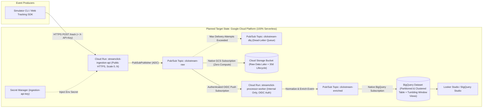

# Đánh giá Mức độ Sẵn sàng & Cơ sở Chuyển dịch lên GCP (GCP Readiness Baseline)

> **Quy ước Phân tách Trạng thái:**
> * **Mục 1 & Mục 2** phản ánh trung thực trạng thái mã nguồn hiện tại (**Current As-Is Baseline**).
> * **Mục 3** mô tả kiến trúc mục tiêu **100% Serverless trên Google Cloud Platform** (**Planned / Target State**) chuẩn bị cho giai đoạn triển khai hạ tầng bằng Terraform và nâng cấp Adapter tiếp theo.

---

## 1. Các Điểm Nối Sẵn sàng cho Cloud trong Codebase Hiện tại (As-Is Seams)

Ngay từ thiết kế ban đầu, **StreamClick** đã xây dựng sẵn bốn nền tảng quan trọng giúp quá trình chuyển dịch lên Cloud không phải viết lại logic nghiệp vụ cốt lõi:

| Thành phần Hiện hữu | Vị trí Mã nguồn | Lợi thế khi Chuyển dịch lên GCP |
| :--- | :--- | :--- |
| **Message Broker Port (`AbstractMessagePublisher`)** | `core/adapters/broker/base.py` | Đã chuẩn hóa 4 phương thức `connect()`, `publish(topic, message, key)`, `flush()`, `close()`. Có thể bổ sung `PubSubPublisher` mà không đổi hợp đồng gọi từ tầng API. |
| **Object Storage Port (`AbstractStorageClient`)** | `core/adapters/storage/base.py` | Đã có sẵn `upload_bytes()` truyền dữ liệu trực tiếp từ bộ nhớ RAM, tương thích tự nhiên với hệ thống tệp phi trạng thái của Cloud Run và GCS SDK. |
| **12-Factor Externalized Settings & GCP Stubs** | `core/config.py`, `.env.example` | Đã tách toàn bộ cấu hình ra biến môi trường qua `pydantic-settings`, có sẵn cờ điều hướng `BROKER_TYPE`, `STORAGE_TYPE` cùng ba biến chờ `GCP_PROJECT_ID`, `GCP_PUBSUB_TOPIC`, `GCP_GCS_BUCKET`. |
| **Stateless Validation & Dual-Payload Ingestion** | `api/main.py`, `core/schemas/clickstream.py` | FastAPI không lưu session trên máy chủ, xác thực chặt chẽ Data Contract `ClickstreamEvent` và hỗ trợ sẵn cả gửi đơn lẻ lẫn gom lô JSON. |

---

## 2. Các Điểm Nghẽn Coupling Cần Gỡ bỏ Trước Khi Lên Cloud (As-Is Gaps)

Kiểm tra trực tiếp mã nguồn phát hiện **6 điểm phụ thuộc cục bộ** sẽ ngăn cản ứng dụng chạy trên môi trường **Serverless Scale-to-Zero** nếu chưa được refactor ở giai đoạn tiếp theo:

1. **Khởi tạo Sớm & Trường Cục bộ Bắt buộc trong `core/config.py`:**
   * Các trường `KAFKA_BOOTSTRAP_SERVERS`, `KAFKA_TOPIC_CLICKSTREAM`, `KAFKA_CONSUMER_GROUP`, `S3_BUCKET_NAME`, và nhóm `POSTGRES_*` hiện không có giá trị mặc định, đồng thời dòng `settings = Settings()` chạy ngay lúc import module. Khi triển khai lên Cloud Run (không còn dùng Kafka/PostgreSQL/MinIO), container sẽ dừng đột ngột vì lỗi `ValidationError` ngay khi khởi động.
2. **Khởi tạo Cứng `RedpandaPublisher` trong `api/main.py`:**
   * Hàm `lifespan` hiện gọi trực tiếp `RedpandaPublisher(bootstrap_servers=settings.KAFKA_BOOTSTRAP_SERVERS)` và `track_event` truyền cứng `settings.KAFKA_TOPIC_CLICKSTREAM`, chưa đi qua lớp Factory đọc `settings.BROKER_TYPE`.
3. **Mô hình Pull-Loop Vô hạn ở `streaming/processor.py` và `batch/datalake_consumer.py`:**
   * Cả hai worker đều chạy vòng lặp kéo dữ liệu liên tục (`app.run(sdf)` và `while True: consumer.poll()`) mà không mở cổng HTTP lắng nghe yêu cầu. Mô hình này không tương thích với hợp đồng container hướng sự kiện (Request-scoped CPU & Scale-to-Zero) của **Cloud Run Services**.
4. **Trạng thái RocksDB Trên Đĩa Cục bộ (`state/`):**
   * `Quix Streams` ghi trạng thái cửa sổ 60s xuống thư mục cục bộ `state/streamclick-realtime-group/`. Trên môi trường Serverless tự động co giãn từ `0 -> N` instances, bộ nhớ container là tạm thời (ephemeral) và không chia sẻ giữa các instance.
5. **Dockerfile Chưa Tuân thủ Hợp đồng Cổng Động & Non-Root:**
   * `api/Dockerfile` cố định `--port 8000` thay vì đọc biến môi trường động `$PORT` (mặc định `8080` trên Cloud Run) và đang thực thi dưới quyền `root`.
6. **Ghi Log Chuỗi Thuần thay vì Structured JSON:**
   * Hệ thống đang dùng `logging.basicConfig` dạng văn bản phẳng, chưa xuất định dạng JSON có trường `severity` để tích hợp bộ lọc truy vết trên **Cloud Logging**.

---

## 3. Kiến trúc Mục tiêu trên GCP — Planned / Target State (100% Serverless)

Để tuân thủ nguyên tắc **Zero Idle Cost** (tuyệt đối không dùng Compute Engine, GKE, Cloud SQL hay Dataflow chạy nền tốn phí theo giờ), kiến trúc Lambda cục bộ sẽ được tinh gọn thành kiến trúc hướng sự kiện hoàn toàn Serverless xoay quanh **Cloud Pub/Sub**, **Cloud Run**, **Cloud Storage** và **BigQuery**:

### Bảng Ánh xạ Chuyển đổi Thành phần (As-Is Local -> Planned GCP Serverless)

| Thành phần Hiện tại (As-Is Local) | Dịch vụ Mục tiêu (Planned GCP) | Chiến lược Chuyển đổi Kỹ thuật |
| :--- | :--- | :--- |
| **FastAPI** (`api/`) | **Cloud Run** (`streamclick-ingestion-api`) | Giữ nguyên FastAPI, bổ sung Factory nạp `PubSubPublisher` qua **Application Default Credentials (ADC)** và khóa bảo vệ `X-API-Key` từ **Secret Manager**. |
| **Redpanda** + Console | **Cloud Pub/Sub** + **Dead-Letter Topic** | Thay thế broker tự quản lý bằng managed Pub/Sub topics (`raw`, `enriched`, `dlq`), tận dụng cơ chế phân nhánh đa subscription. |
| **Batch Consumer** (`batch/`) + **MinIO** | **Pub/Sub Cloud Storage Subscription** + **GCS** | Xóa bỏ tiến trình `while True` gom lô thủ công; dùng tính năng tích hợp gốc của Pub/Sub ghi thẳng tệp lưu trữ xuống GCS với chi phí CPU bằng không, kèm triển khai `GCSStorageClient` cho tiện ích đọc/ghi. |
| **Quix Streams** (`streaming/`) | **Internal Cloud Run Worker** (`--no-allow-unauthenticated`) | Chuyển sang HTTP Push endpoint nhận gói tin từ Pub/Sub qua xác thực **OIDC Service Account**, thực hiện chuẩn hóa `product_id`, làm phẳng `DeviceContext` và xuất **Structured JSON Logs**. |
| **PostgreSQL** + **DuckDB** | **BigQuery** (Partitioned & Clustered Table + SQL Views) | Sử dụng **Native Pub/Sub BigQuery Subscription** nạp dữ liệu đã làm giàu vào bảng phân vùng theo `DATE(timestamp)` và phân cụm theo `(event_type, product_id)`; tái tạo bảng cửa sổ 60s bằng SQL Views phi máy chủ. |
| **Grafana** (`:3000`) | **Looker Studio** / **BigQuery Studio** | Kết nối trực tiếp vào các View trên BigQuery mà không cần duy trì container dashboard chạy nền. |
| **Docker Compose** (`docker-compose.yml`) | **Terraform** (`infrastructure/terraform/`) + **Artifact Registry** | Mã hóa 100% hạ tầng (APIs, Least-Privilege Service Accounts, IAM, Pub/Sub, GCS, BigQuery, Cloud Run) đảm bảo chu trình `terraform apply` / `terraform destroy` sạch hoàn toàn. |

---

## 4. Danh mục Công việc Mở đầu Lộ trình Di chuyển (Next Steps Roadmap)

Sau khi chốt bộ tài liệu cơ sở này, quá trình chuyển dịch lên GCP sẽ diễn ra tuần tự qua 5 giai đoạn:
1. **Phase 1 — GCP Bootstrap, Billing Guardrail & Terraform Foundation:** Thiết lập Billing Budget Alert bảo vệ gói tín dụng thử nghiệm, cấu hình `gcloud` ADC và khởi tạo khung Terraform + bật GCP APIs.
2. **Phase 2 — Core Data Backbone:** Khai báo Service Accounts tối thiểu quyền, Pub/Sub topics/DLQ, GCS bucket và bảng/view BigQuery bằng Terraform.
3. **Phase 3 — Application Refactoring & Containerization:** Mở rộng `core/config.py`, viết `PubSubPublisher` & `GCSStorageClient`, chuyển đổi `streaming` worker sang HTTP Push kèm Structured Logging và đẩy image lên Artifact Registry.
4. **Phase 4 — Serverless Compute & Identity Wiring:** Triển khai Cloud Run public/internal qua Terraform và nối dây xác thực OIDC giữa Pub/Sub và Worker.
5. **Phase 5 — Verification Gates & Reproducibility Drill:** Kiểm thử tải đầu-cuối, xác minh `403 Forbidden` Zero-Trust và kiểm tra chu trình `terraform destroy` -> `terraform apply`.
